# CW4I


CW4I decodes every Morse station in the audio band at once.
It comes as a library and an application.
The Go version is kept in the branch v1.

## Workspace

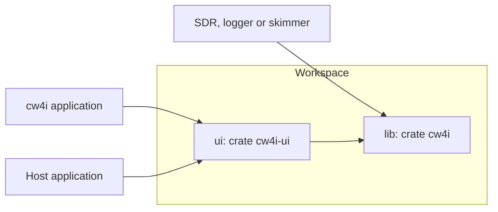

| Directory | Crate | Role |
|---|---|---|
| `lib` | `cw4i` | Streaming decoder, simulator and bench, pure Rust without I/O. |
| `ui` | `cw4i-ui` | egui panel, waterfall, audio input and the `cw4i` application (feature `app`). |

## Get Started

Download the nightly build [here](https://github.com/nextzlog/cw4i/releases/tag/nightly).

| OS | Start |
|---|---|
| Windows | Start `cw4i.exe`. |
| macOS | Install `cw4i.app` from `cw4i.dmg`. |

## Application

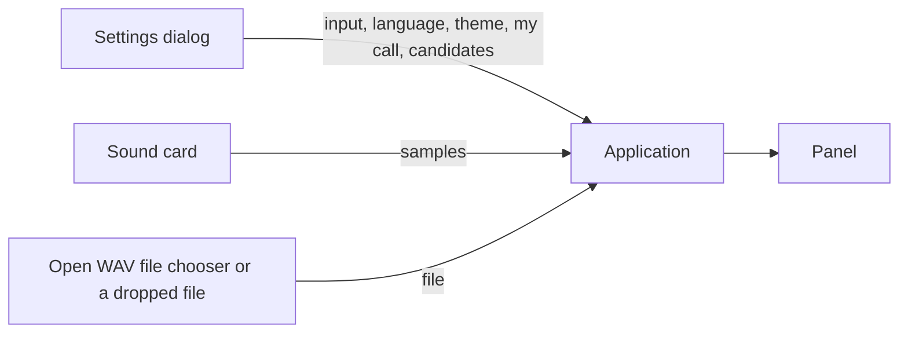

```text
+---------------------------------------------------------------------------+
| ▶ Start  🗁 Open…  Clear  ◧ ⬒ ◨ ⇄ | ● Stopped                ⚙ Settings |
+---------------------------------------------------------------------------+
| waterfall                                                                 |
+---------------------------------------------------------------------------+
| Press Start, open a WAV file, or drop one here.                           |
| lanes                                                                     |
+---------------------------------------------------------------------------+
```

| Toolbar | Icon | Role |
|---|---|---|
| Start, Stop | `PLAY`, `STOP` | Listens to the sound card, or asks the host with `host_input`. |
| Open…, Stop WAV | `FOLDER_OPEN`, `STOP` | Decodes a WAV file, or asks the host with `host_input`. |
| Clear | | Clears the stations. |
| Left, top, right | `SIDEBAR_SIMPLE`, `SQUARE_SPLIT_VERTICAL`, `SQUARE_HALF` | Puts the waterfall at the left, top or right. |
| Flow | `ARROWS_LEFT_RIGHT` | Reverses the waterfall flow. |
| Status | `CIRCLE` | Shows the source; red while running. |
| Settings | `GEAR` | Opens the settings dialog. |

The icons are the Phosphor font of the zLog toolbar, in `ui/data`, drawn by `cw4i_ui::icon`.
Icon-only buttons carry their tooltip as the accessible label.

| Setting | Choice |
|---|---|
| Input | Default device or a sound card |
| Language | English or 日本語 |
| Theme | System, Light or Dark |
| My call | Its words are shown in green. |
| Show candidates | Also shows the candidate readings. |

The glyphs come from the system fonts through the font provider of eframe.

## Panel

A host can show the same panel in its own window.

```toml
cw4i-ui = { git = "https://github.com/nextzlog/cw4i", default-features = false }
cw4i = { git = "https://github.com/nextzlog/cw4i" }
```

| Item | Role |
|---|---|
| `Cw4i` | Draws the controls, the waterfall and the lanes into an egui `Ui`. |
| `toolbar`, `body`, `ui` | The toolbar with host items at the right, the rest, or both. |
| `ToolbarItems` | Toolbar items a host hides; `settings: false` hides ⚙ Settings. |
| `settings_ui` | The panel settings, for a host to draw in its own options page. |
| `host_input`, `host_running` | The host feeds the samples; Start, Stop and Open… emit events, and `host_running` selects Stop. |
| `host_call` | The host supplies my call, and `settings_ui` omits it. |
| `app` | The settings fields and preferences of the application. |
| `Pick` | A picked callsign or number; `take_picks` returns them. |
| `Event` | A pick, a clicked station, a station that appears or is lost, Start, Stop, Open WAV or Settings. |
| `settings` | Key and value pairs to persist; `load_setting` restores them. |
| `CutTable` | Cut numbers, letter to digit; `set_cut_table` and `cut_table` on `Cw4i`. |
| `Stations` | Stations built from the decoder events. |
| `decode` | Decodes a whole recording. |

| Layout | Behaviour |
|---|---|
| Toolbar | One row when wide, wrapping when narrow; ⚙ Settings stays at the right. |
| Side or bottom area | The toolbar wraps, and each lane puts its header above the text. |
| Waterfall | The newest data is next to the lanes; a toolbar button reverses the flow. |

### Panel Events

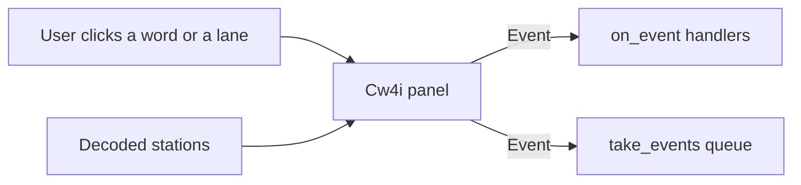

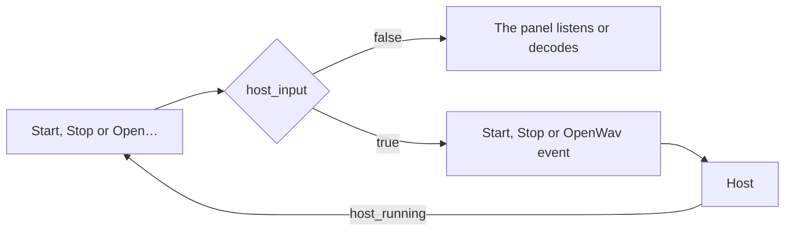

| Event | Fields | Meaning |
|---|---|---|
| `Pick` | text, kind | A clicked callsign or number word. |
| `Contact` | station, callsign, report, exchange, raw_exchange, freq, wpm, p, time | A clicked lane with what that station sent. |
| `Appeared` | station, freq | A station is confirmed. |
| `Lost` | station, callsign | A station is gone. |
| `Start` | | Start was pressed with `host_input`, so the host starts listening. |
| `Stop` | | Stop was pressed with `host_input`, so the host stops. |
| `OpenWav` | | Open WAV was pressed, so the host chooses a file. |
| `Settings` | | ⚙ Settings was pressed, so the host opens its settings. |

```rust
panel.on_event(|e| if let cw4i_ui::Event::Contact(c) = e { println!("{:?} {:?}", c.callsign, c.exchange) });
```

| Contact field | Rule |
|---|---|
| callsign | Sent after DE or repeated most, never my call. |
| report | 5NN, 599 or 59, with cut numbers read as digits. |
| exchange | The rest after the report. |

The default cut table maps T and O to 0, A to 1, U to 2, V to 3, E to 5 and N to 9.
A host table also applies to reports, exchanges and picked numbers.

```rust
panel.set_cut_table(cw4i_ui::CutTable::new([('O', '0'), ('A', '1'), ('N', '9')]));
```

## Decoder Library

```rust
let mut dec = cw4i::Decoder::new(48000);
for block in audio.chunks(128) {
    for event in dec.push(block) {
        if let cw4i::Event::Commit { freq, text, .. } = event {
            println!("{freq:.0} Hz: {text}");
        }
    }
}
let tail = dec.flush();
```

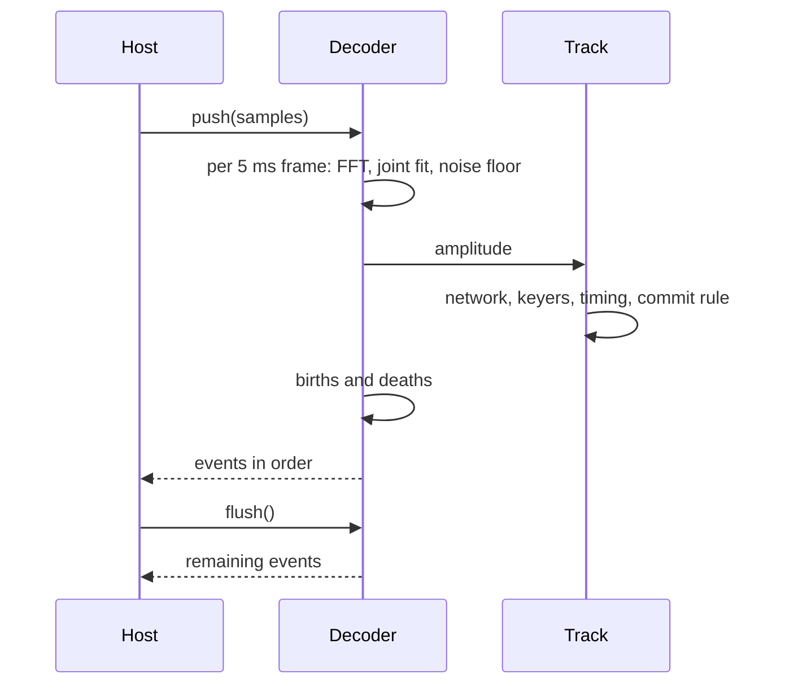

## Events

| Event | Fields | Meaning |
|---|---|---|
| `TrackBorn` | freq, candidate | A new track appears. |
| `TrackConfirmed` | freq | The candidate is a station. |
| `Commit` | freq, text, chars | Confirmed characters, never revised. |
| `Tentative` | held, text, pattern, guess, p, alts, candidate | Uncommitted state of a track. |
| `Token` | start, text, kind, verdict, p | A closed token of committed text with its verdict. |
| `Correction` | retract, text | Reserved. |
| `TrackLost` | candidate | The track ended. |

Every event carries the track number and the sample index of its decision.
Probabilities are calibrated: a character of probability 0.95 is right about 95 times in 100.

## Decoder

### Pipeline

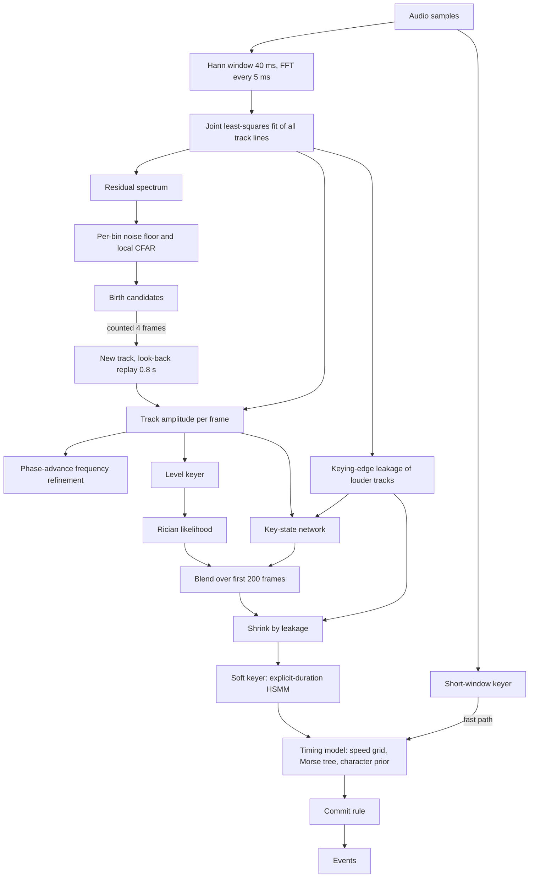

| Stage | Detail |
|---|---|
| Joint fit | Each line has a steady and a ramp column. |
| Ramp column | In-phase part follows keying edges; quadrature part models frequency error and stays near its slow average. |
| Quadrature hold | Keeps the ramp from absorbing a neighbour 25 to 50 Hz away. |
| New line position | Fitted on the last 4 spectra together with nearby lines and ramps. |
| Level keyer | Tracks noise and key-down levels. |

### Key-State Network

The network is trained offline on synthetic signals with known key state.
Its training inputs come from the decoder's own feature code.

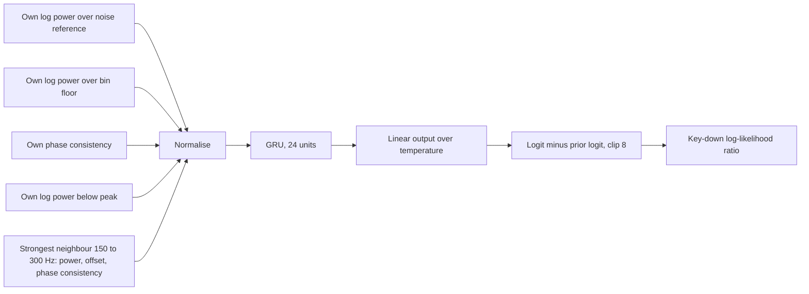

Neighbours closer than 150 Hz are left out, since they made the network follow the neighbour.
The joint fit, the leakage model and the ghost check handle them instead.

### Soft Keyer

Each element type is a chain of forced stages ending in a geometric tail.

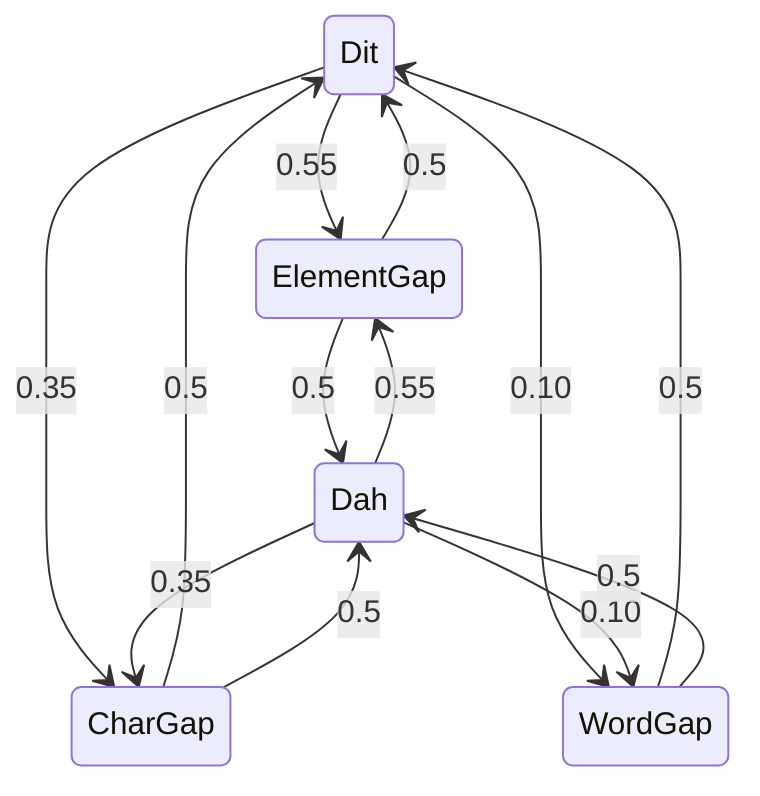

The Morse tree weights each dit, dah and character end by tempered character frequencies.
Ambiguous gaps thus favour whole, likely characters.

### Track Life

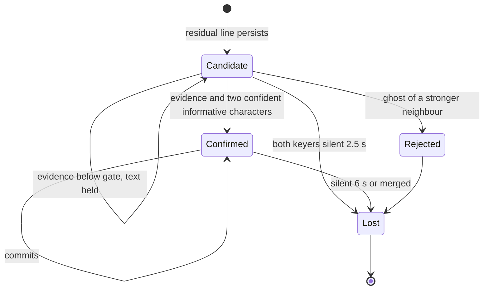

### Births, Ghosts and Leakage

A keying edge leaks into neighbours, most at 40 to 60 Hz, about 16 dB below key-down in the worst frame.
The leakage is estimated per frame from the key-down share in the window and its change.

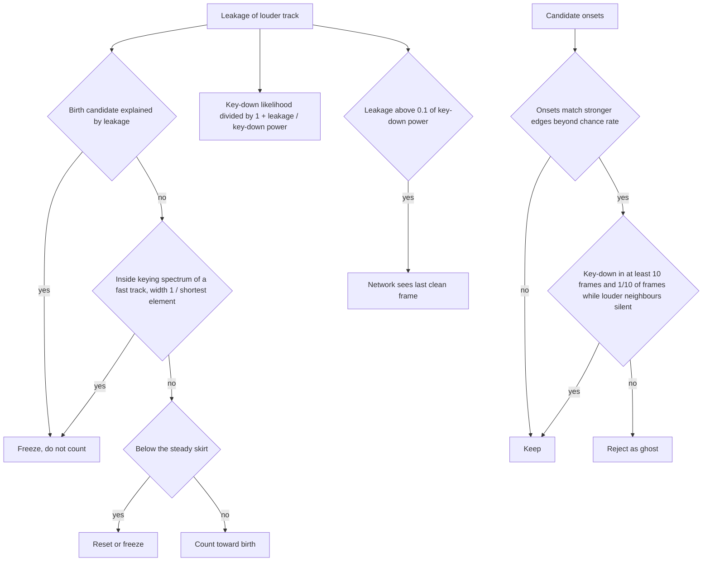

The shortest element is the lower quartile of recent elements.
In a track's first 200 ms it is taken as the 160 WPM minimum.

### Fast Path

Above about 80 WPM a station outruns the 40 ms window.

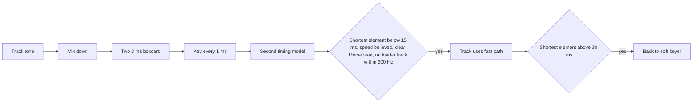

### Commit Rule

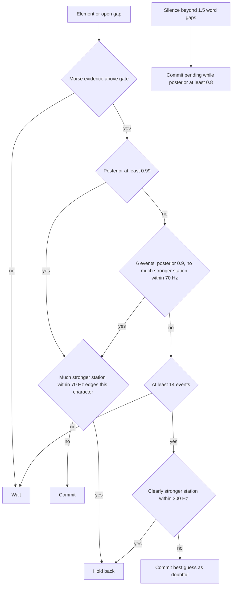

| Neighbour | Effect on the weaker track |
|---|---|
| Confirmed, 6 dB stronger, within 300 Hz | Character prior off; doubtful characters held back. |
| 10 dB stronger, within 70 Hz | Commit only at 0.99. |
| Same, edge within 2 frames of an element boundary or in the space before or within | Character held back and not learnt from. |

### First Character

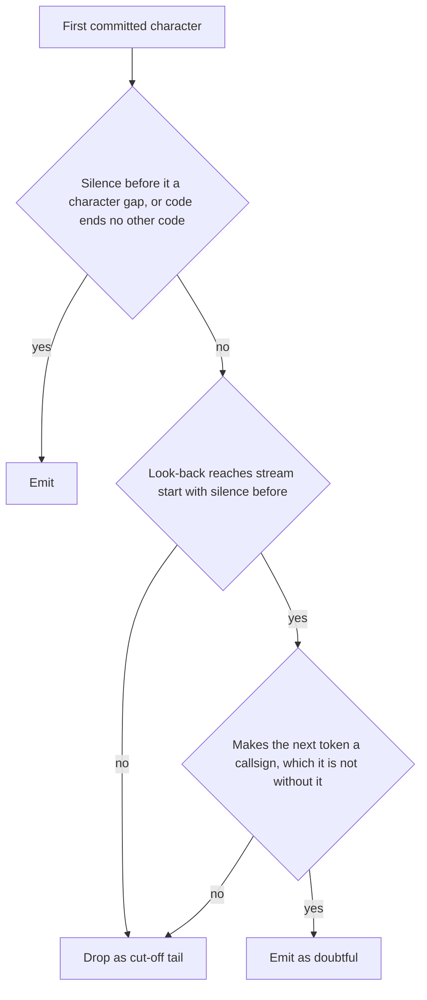

## Tokens

Committed characters never change, but each closed token gets a verdict.

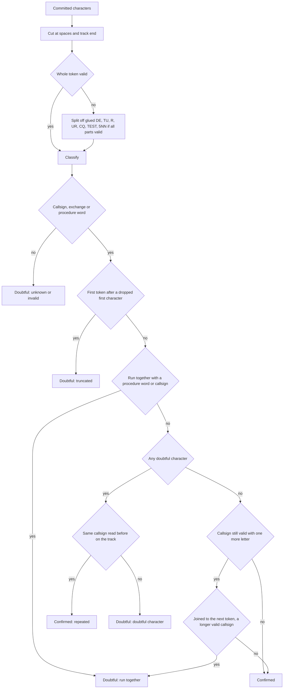

A lost character gap can split a callsign, such as JA0BZ E for JA0BZE.
Such a callsign waits for the next token or the track end.

| Syntax | Rule |
|---|---|
| Callsign | Prefix of one letter (B F G I K M N R W) or two characters, one area digit, suffix of 1 to 4 letters. |
| JA to JS | Suffix of 2 or 3 letters. |
| 7K to 7N | Area 1 to 4, suffix of 3 letters. |
| JD | Area 1. |
| Slash | Prefix before; portable digit, P, M, MM, AM, A, QRP or country prefix after. |
| Exchange | A report such as 5NN or 599, or a number with cut digits and at least one real digit, then at most one of P, L, M, H. |
| Database | None. |

## Probabilities

The timing posterior is overconfident, so small logistic maps, fitted offline on synthetic signals, calibrate it.
The maps change no character, commit or timing.

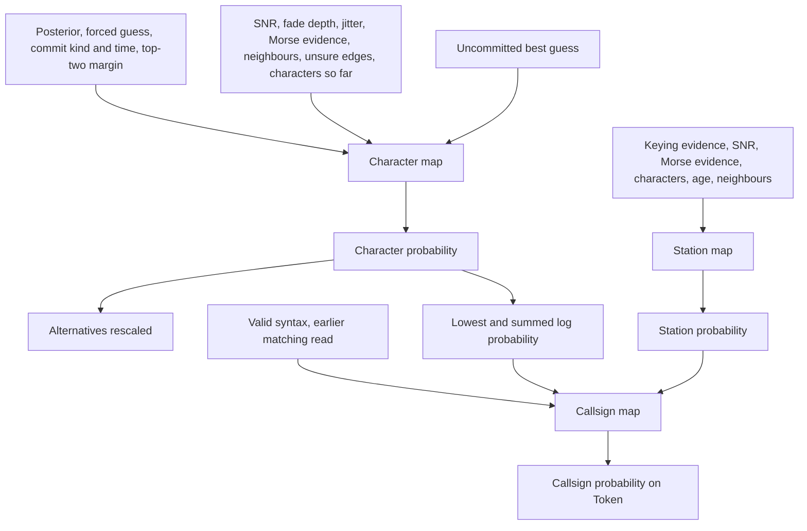

Other tokens carry the product of their character probabilities.
The station probability comes with each track state.

## Build

```sh
$ cargo build --release -p cw4i-ui
$ ./target/release/cw4i
```

On macOS, this script wraps the build into `dist/CW4ISR.app`, which starts without a terminal.

```sh
$ scripts/macos.sh CW4ISR cw4i
$ open dist/CW4ISR.app
```

Given WAV files, the application prints the stations without a window.

```sh
$ ./target/release/cw4i recording.wav
```

## Test

```sh
$ cargo test --workspace
```

The confirmation classifier, which tells a candidate station from noise keyed like Morse, is trained on simulated scenes only.

```sh
$ cargo run --release --manifest-path tools/train_confirm/Cargo.toml -- lib/src/confirm_weights.rs
$ cargo fmt --all
```

## Contribution

Feel free to make issues at [nextzlog/todo](https://github.com/nextzlog/todo).

## Simulator

The module `cw4i::sim` renders seeded CW audio with its ground truth.

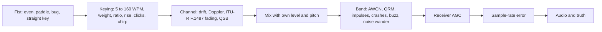

Fists add jitter and drifting speed, weight and dah ratio.

| Preset | Doppler spread | Delay |
|---|---|---|
| `Channel::MID_QUIET` | 0.1 Hz | 0.5 ms |
| `Channel::MID_MODERATE` | 0.5 Hz | 1 ms |
| `Channel::MID_DISTURBED` | 1 Hz | 2 ms |
| `Channel::LOW_DISTURBED` | 10 Hz | 6 ms |
| `Channel::HIGH_MODERATE` | 10 Hz | 3 ms |
| `Channel::HIGH_DISTURBED` | 30 Hz | 7 ms |

| Scene | Content |
|---|---|
| `Scene::single` | One station at 700 Hz. |
| `Scene::pileup` | Stations within a pitch spread, levels within 10 dB, each sending its callsign twice. |
| `Scene::contest` | Callers with paddles and mild QSB, each sending a callsign and an exchange. |
| `Scene::realistic` | Measured conditions: SNR -5 to 10 dB, QSB up to 12 dB at 0.05 to 0.5 Hz, impulses, straight key or bug, a neighbour up to 5 dB stronger. |
| `Scene::silence` | Background without CW. |
| `Scene::operating` | Minutes of a contest band: a running station, random callers, mixed fists, fading, crashes and AGC. |

```rust
let scene = cw4i::sim::Scene::single("CQ TEST DE JA1ZLO K", 45.0, 10.0, 1);
let cer = cw4i::sim::score(&scene, cw4i::Config::default())[0].cer;
```

## Bench

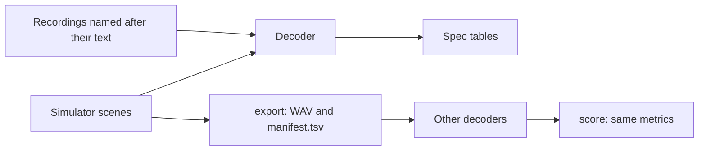

| Mode | Sweep |
|---|---|
| `sweep` | 10 to 120 WPM at no noise, 20, 10 and 5 dB. |
| `pileup` | 1 to 6 stations within 250 Hz at 18 to 28 and 30 to 45 WPM. |
| `scene` | Two minutes of a contest band: CQ, random callers, mixed fists and levels, fading, crashes and AGC. |
| `cpu` | Time per second of audio with 1, 10 and 20 stations. |
| `contest` | Single callers at 25 to 45 WPM and 5 to 20 dB, and pile-ups of 2, 4 and 8: callsigns, exchanges, inserted T or E, latency. |
| `hf` | Channel presets times fists at 25 and 40 WPM, impairments, and pile-ups under fading. |
| `weak` | 0 to -10 dB at 15 to 30 WPM, and a station 20 to 40 dB below a strong one at 0 to 200 Hz. |
| `realistic` | `Scene::realistic`, alone and with a neighbour. |
| `silence` | False characters per minute on backgrounds without CW and in gaps between transmissions. |
| `files` | CER on the recordings in a directory (default `../morse_test_data`). |
| `survey` | SNR, fading and impulses of the recordings. |
| `export DIR` | Contest scenes as WAV files with `manifest.tsv`. |
| `score DIR OUT` | Scores `OUT/<file>.txt` from any decoder against the manifest. |

```sh
$ cargo run --release -p cw4i --example bench contest
$ cargo run --release -p cw4i --example bench files ../morse_test_data
```

## Specification

SNR is the key-down carrier power in 2500 Hz unless noted.
Keyed text averages about 3 dB lower, and the power in 500 Hz is 7 dB higher.

| WPM | No noise | 20 dB | 10 dB | 5 dB |
|---|---|---|---|---|
| 10 to 60 | 0 % | 0 % | 0 % | 0 % |
| 80 | 0 % | 0 % | 0 % | 8 % |
| 100 | 2 % | 2 % | 2 % | 6 % |
| 120 | 2 % | 0 % | 0 % | 1 % |

| Key-down SNR in 2500 Hz | 0 dB | -3 dB | -6 dB | -8 dB | -10 dB |
|---|---|---|---|---|---|
| Average SNR in 500 Hz | 4 dB | 1 dB | -2 dB | -4 dB | -6 dB |
| CER at 15 to 30 WPM | 0 % | 0 to 2 % | 5 to 12 % | 30 to 48 % | 63 to 96 % |

| Contest, average SNR 5 to 20 dB in 500 Hz | 25 to 45 WPM |
|---|---|
| Callsigns and exchanges shown correctly | 100 % |
| CER, inserted T or E | 0 % |
| Callsign shown after its last element | 0.4 to 0.6 characters (1.1 at 45 WPM, 5 dB) |

| Pile-up | 2 | 3 | 4 | 6 | 8 |
|---|---|---|---|---|---|
| CER at 18 to 28 WPM, 20 dB | 0.4 % | 0.8 % | 0.4 % | 1.5 % | |
| CER at 30 to 45 WPM, 20 dB | 2.1 % | 2.2 % | 2.3 % | 4.0 % | |
| Contest callsigns at 30 to 40 WPM, 10 dB in 500 Hz | 100 % | | 88 % | | 69 % |

| Channel at 25 WPM | 20 dB | 10 dB | 5 dB |
|---|---|---|---|
| No fading, any fist | 0 % | 0 % | 0 % |
| Mid-latitude quiet | 0 % | 1 to 3 % | 3 to 9 % |
| Mid-latitude moderate and disturbed | 0 to 5 % | 3 to 23 % | 16 to 31 % |
| Low- and high-latitude flutter | 68 to 100 % | 80 to 92 % | 82 to 96 % |

| Station below a strong one, 25 WPM, 10 dB | 0 Hz | 50 Hz | 100 Hz | 200 Hz |
|---|---|---|---|---|
| 20 dB below | 100 % | 99 % | 8 % | 0 % |
| 30 dB below | 100 % | 98 % | 41 % | 0 % |
| 40 dB below | 100 % | 100 % | 56 % | 3 % |

| Background without CW | False characters per minute |
|---|---|
| White noise, static crashes, impulses, machine buzz, carriers, AGC breathing, wandering or stepping noise level | 0 |
| Gaps of 20 s between transmissions | 0, quiet within 0.2 s |

| Recordings (32 labelled files) | CER |
|---|---|
| Whole decoded text | 13.5 % |
| Best-matching stretch of the decoded text | 9.5 % |
| Conditions of the recordings, simulated | 15 to 18 % |

| Operating scene, 15 dB in 500 Hz, callers 0 to 12 dB weaker with fading | Band noise | With static crashes | With crashes and AGC |
|---|---|---|---|
| Callsign and exchange shown correctly | 50 % | 31 % | 26 % |
| Callers missed | 41 % | 52 % | 57 % |
| Callsign latency | 0.5 characters | 0.5 characters | 0.5 characters |
| Wrong callsigns per hour | 50 | 80 | 60 |
| Characters per hour with no station on air | 0 | 65 | 383 |

| Processing on one core | Time per second of audio |
|---|---|
| One station, 8 or 48 kHz | 0.015 to 0.022 s |
| 10 stations | 0.06 to 0.07 s |
| 20 stations | 0.12 to 0.14 s |
| One station at 120 WPM | 0.03 s |

## License

### Author

[無線部開発班](https://nextzlog.dev)

- JG1VPP
- JS2FVO

### Clauses

- [MIT License](LICENSE)
- The Phosphor Icons is under the [MIT License](ui/data/LICENSE).
