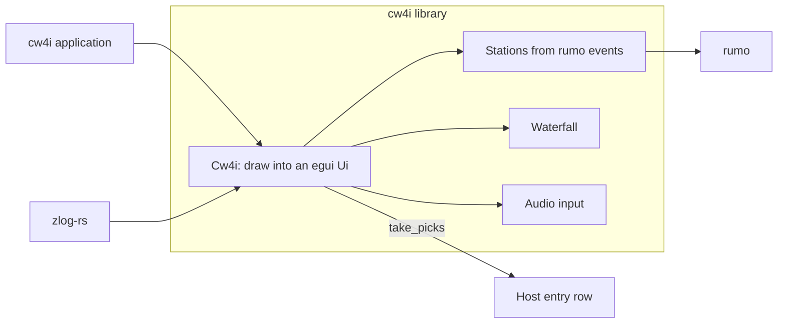

CW4ISR
====


CW4ISR is a Morse decoder that reads every station in the audio band at once.
Decoding is done by [rumo](https://github.com/nextzlog/rumo).
The Go version is kept in the branch v1.

## Get Started

Download the nightly build [here](https://github.com/nextzlog/cw4i/releases/tag/nightly).

### Windows

Start `cw4i.exe`.

### macOS

Install `cw4i.app` from `cw4i.dmg`.

## Library

The crate is also a library, so that a host such as [zlog-rs](https://github.com/nextzlog/zlog-rs) shows the same decoder in its own window.



| Item | Role |
|---|---|
| `Cw4i` | Draws the controls, the waterfall and the lanes, and hands out picked words. |
| `Pick` | A picked callsign or number. |
| `Stations` | Stations built from the events of rumo. |
| `decode` | Decodes a whole recording. |

A host depends on the crate without the application feature.

```toml
cw4i = { git = "https://github.com/nextzlog/cw4i", default-features = false }
```

## Build

```sh
$ cargo build --release
$ ./target/release/cw4i
```

On macOS, wrap the build into `dist/cw4i.app` with the script below, so that it starts without a terminal window.

```sh
$ scripts/macos-app.sh
$ open dist/cw4i.app
```

Given WAV files, the application prints the stations heard without opening a window.

```sh
$ ./target/release/cw4i recording.wav
```

## Test

```sh
$ cargo test
```

## Contribution

Feel free to make issues at [nextzlog/todo](https://github.com/nextzlog/todo).

## License

### Author

[無線部開発班](https://nextzlog.dev)

- JG1VPP
- JS2FVO

### Clauses

[MIT License](LICENSE)
